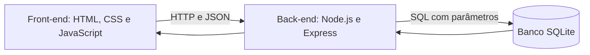
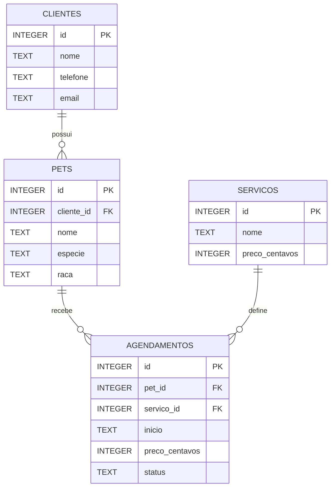

# Arquitetura e regras

## As três camadas



As três camadas são responsabilidades distintas; não precisam estar em três computadores. O Express serve os arquivos da interface e a API no mesmo endereço. O navegador não abre o SQLite diretamente.

Exemplo: ao clicar **Salvar cliente**, `public/app.js` lê o formulário e faz `POST /api/clientes`. `src/app.js` valida os campos e faz um INSERT. `src/database.js` mantém a conexão com o SQLite. O banco salva o cliente e devolve seu ID. A tela pede a lista atualizada com GET e mostra o resultado.

Separação nesta implementação:
- **Apresentação:** `public/index.html` organiza os elementos, `style.css` cuida da aparência, `app.js` das interações.
- **Aplicação:** `src/app.js` concentra rotas e regras; `server.js` inicia o processo e escolhe o banco.
- **Persistência:** `src/database.js`, `src/schema.sql` e o arquivo `data/*.sqlite`.

Para este escopo, as consultas ficam próximas das regras no back-end para facilitar a leitura. Uma evolução possível é extrair repositórios e serviços, sem alterar a separação entre navegador, servidor e banco.

## Modelo de dados



**PK** é uma chave primária: identifica um registro. **FK** é uma chave estrangeira: referencia outro registro. Um cliente pode ter vários pets; cada pet tem exatamente um cliente. Um pet pode ter vários agendamentos; cada agendamento tem um serviço.

| Tabela | Finalidade | Regra principal |
|---|---|---|
| clientes | Tutores e contatos | Nome e telefone obrigatórios; e-mail opcional |
| pets | Animais | Tutor existente, nome e espécie válidos |
| servicos | Catálogo inicial | Preço inteiro em centavos |
| agendamentos | Agenda e histórico | Pet e serviço existentes; horário exclusivo para não cancelados |

Há campos opcionais com texto vazio, para evitar complexidade com valores nulos. Os IDs são gerados pelo SQLite. Clientes e pets com nomes iguais são permitidos; a seleção exibe ID para diferenciá-los.

## Regras de negócio

1. Cliente: nome até 100 caracteres; telefone com DDD e 10 ou 11 dígitos, permitindo pontuação convencional; e-mail opcional com validação simples.
2. Pet: tutor existente, nome até 100 caracteres, espécie Cachorro/Gato/Outro, raça opcional.
3. Exclusão: cliente com pets e pet com qualquer agendamento não podem ser apagados. Cancelar atendimento mantém seu histórico.
4. Agenda: uma estação de trabalho; todos os serviços duram 60 minutos; horários inteiros entre 08h e 17h, de qualquer dia.
5. Data/hora armazenada como texto `AAAA-MM-DDTHH:00`, interpretada como hora civil de Brasília. Não há conversão para UTC.
6. Datas de 2026 a 2100 são aceitas, inclusive passadas, para histórico e gravações acadêmicas.
7. Conflito: índice único parcial no banco impede repetir início se o status for Agendado ou Concluído. Não depende só do formulário.
8. Cancelamento libera horário e preserva registro. Para remarcar, cancelar e criar outro.
9. Estado inicial: Agendado. Pode passar para Cancelado ou, na final, Concluído. Estados encerrados não são reabertos.
10. Preço copiado para o agendamento, mantendo o valor daquele serviço no histórico.
11. Painel: inclui todo o histórico do banco atual. Receita demonstrativa = soma de `preco_centavos` dos Concluídos, dividida por 100 na exibição.
12. Não há validação de CPF nem unicidade de e-mail/telefone; não foram exigidos no escopo.

## Contrato da API

Todas as respostas são JSON. Erros retornam `{ "erro": "mensagem" }`. Criação retorna status 201 e `{ "id": 1 }`. Atualizações e exclusões retornam `{ "ok": true }`.

| Método e rota | Etapa mínima | Uso |
|---|---|---|
| GET /api/config | AC1 | Etapa e nível |
| GET /api/clientes | AC1 | Listar clientes; busca ocorre na tela |
| POST /api/clientes | AC1 | Cadastrar cliente |
| PUT /api/clientes/:id | AC1 | Substituir dados do cliente |
| DELETE /api/clientes/:id | AC1 | Excluir se não houver vínculos |
| GET /api/pets | AC2 | Listar pets com nome do tutor |
| POST /api/pets | AC2 | Cadastrar pet |
| PUT /api/pets/:id | AC2 | Substituir dados do pet |
| DELETE /api/pets/:id | AC2 | Excluir pet sem histórico |
| GET /api/servicos | AC3 | Listar catálogo fixo |
| GET /api/agendamentos | AC3 | Listar agenda com pet, tutor e serviço |
| POST /api/agendamentos | AC3 | Agendar |
| PATCH /api/agendamentos/:id/status | AC3 | Cancelar; concluir somente na final |
| GET /api/painel | Final | Contagens e valores por serviço |

Exemplos de corpos:

```json
{ "nome": "Ana", "telefone": "(11) 99999-1234", "email": "ana@example.com" }
```

```json
{ "cliente_id": 1, "nome": "Luna", "especie": "Gato", "raca": "SRD" }
```

```json
{ "pet_id": 1, "servico_id": 1, "inicio": "2026-11-08T09:00" }
```

```json
{ "status": "Concluído" }
```

PUT exige os campos completos, como na criação. IDs podem ser números ou strings numéricas dos formulários. O preço é determinado pelo servidor; não é aceito como preço livre do navegador.

Códigos: **400** dados inválidos, **403** etapa ou origem bloqueada, **404** registro/rota inexistente, **409** conflito de vínculo/horário/estado, **500** falha inesperada.

## Decisões técnicas e limites

SQL usa parâmetros `?` para os dados recebidos. A função de existência recebe nomes de tabelas definidos no código, nunca do usuário. O front-end escapa textos antes de montar linhas HTML. O servidor limita o tamanho do JSON e recusa gravações provenientes de outra origem de navegador.

O servidor só escuta em `127.0.0.1`. Não existe autenticação ou autorização por pessoa. Os modos AC são limites de demonstração e não controle de acesso de usuários. Não publicar o servidor diretamente na internet sem redesenhar acesso, proteção e hospedagem.

SQLite síncrono e consultas simples atendem a uma demonstração acadêmica pequena. Não há paginação, concorrência de alta escala, edição de catálogo, cadastro de funcionários ou recebimentos financeiros.
